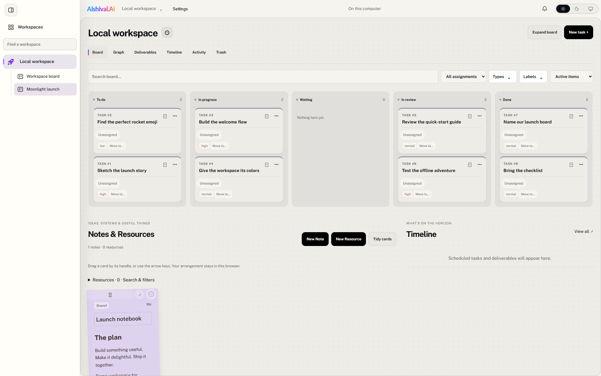
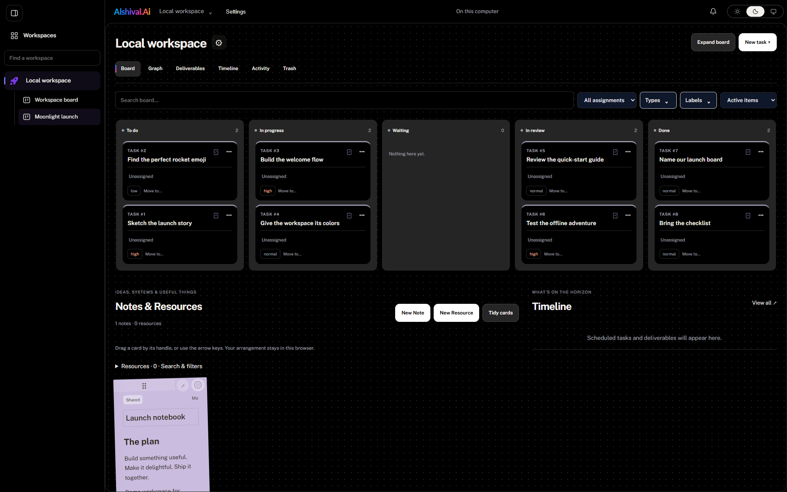
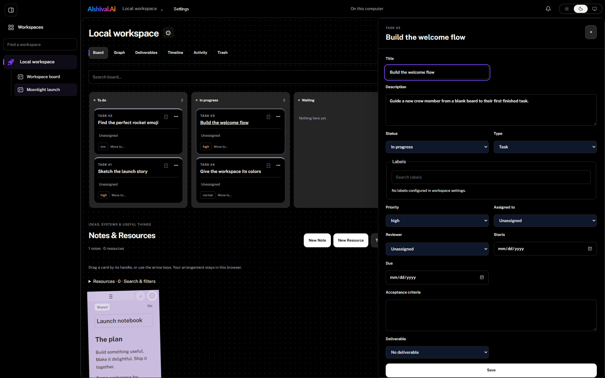

# Alshitask · your workspace, your way 🚀

Give the big idea a board. Give the tiny task a home. Bring your notes, resources, and favorite MCP assistant along for the ride.

**Alshitask** (shown as **Alshival.Ai** in your app launcher) is an open-source, standalone workspace for Windows and Ubuntu. Work locally without an account, then optionally connect to [Alshival.Ai](https://alshival.ai/) for team collaboration.

[Download the desktop app](https://github.com/Alshival-Ai/alshitasks/releases/latest) · [Take the board tour](https://docs.alshival.ai/board-tour/) · [Documentation](https://docs.alshival.ai/alshitask/) · [Wiki](https://github.com/Alshival-Ai/alshitasks/wiki)



*A real board, a fictional launch, and one very important rocket-emoji task. Screenshots use synthetic demo content.*

## Pick your launchpad

| Where you work | How to start |
| --- | --- |
| **Windows 10/11 x64** | Download `alshitasks_<version>_x64_setup.exe` from [Releases](https://github.com/Alshival-Ai/alshitasks/releases/latest). Install for your user and launch **Alshival.Ai** from Start. Python is included. |
| **Ubuntu 26.04 amd64** | Download the `.deb`, then run `sudo apt install ./alshitasks_<version>_amd64.deb` using its actual filename. Open **Alshival.Ai** from the application menu. |
| **Your server / VM** | Try the [browser/server preview](https://docs.alshival.ai/server-mode/): the same board UI and MCP tools, a separate owner login, and your own storage. |
| **Hosted team workspace** | Sign in at [alshival.ai](https://alshival.ai/). Collaboration follows your plan and workspace permissions. |

Server mode is currently available from [`feat/server-mode`](https://github.com/Alshival-Ai/alshitasks/tree/feat/server-mode) in [PR #1](https://github.com/Alshival-Ai/alshitasks/pull/1); the v0.1.37 desktop installers do not include this distribution. There is no published macOS desktop installer. Mac users can use the portal or a browser connected to a server instance.

For a server using the default `http://127.0.0.1:43120` origin, opening `http://localhost:43120/` redirects to the configured address before sign-in. API and MCP clients should use the configured base URL directly.

## A board that keeps the context

- **Tasks with somewhere to go.** Statuses, priorities, types, labels, assignments, and review help turn “we should” into “we did.”
- **Notes beside the work.** Keep decisions, attachments, resources, and project context close at hand.
- **More than a list.** Explore the board, graph, timeline, and activity views. Resources can carry logs and monitoring, too.
- **A little personality.** Choose a colorful workspace icon. Go light, dark, or follow your system.
- **Room for an assistant.** MCP provides workspace tools with owner, read-only, or scoped access.
- **Local work that stays yours.** SQLite storage, offline desktop work, and exportable backups. Portal sync is optional.



*Same mission. Night shift.*

## From first card to finished work

Open your local workspace, choose **New task +**, and write down the next useful step. Click a card for its details; use **Move to…** or its status field as work progresses. Add a note for the why, not just the what.



The [five-minute board tour](https://docs.alshival.ai/board-tour/) walks through a small launch project. The [installation guide](https://docs.alshival.ai/desktop-setup/) covers startup, updates, and recovery.

## Bring your team when you're ready

Connect your own Alshival.Ai account in Settings using browser OAuth. Authorized workspaces sync automatically. **Local boards stay local until you explicitly publish them.** Shared edits respect portal permissions; overlapping edits become conflicts to review and rejected edits remain drafts.

Standalone use does not require a subscription. Paid membership adds hosted team collaboration. Billing and administrative tools stay in the portal. A self-hosted server has one owner; shared team access is handled through Alshival.Ai.

Connections refresh credentials automatically within the portal's accepted refresh window. Revoked access or an extended absence can require sign-in again. See [Connect and sync](https://docs.alshival.ai/portal-sync/).

## Bring your assistant, too

Use the MCP configuration shown in Settings. On Linux, `alshitasks mcp` provides local stdio access through the running per-user service:

```bash
alshitasks mcp --read-only
```

Omit `--read-only` for local-owner workspace access, or create a scoped grant:

```bash
alshitasks grant --scopes project:read,project:write --name 'My assistant'
alshitasks mcp --grant GRANT_ID_FROM_PREVIOUS_COMMAND
```

On Windows, copy the generated configuration with the bundled Python and CLI paths. [Alshival Local](plugins/alshival-local/README.md) offers quick assistant setup; the separate Alshival portal plugin connects through OAuth. Neither plugin turns on synchronization automatically. Server preview clients use named bearer tokens at `/mcp`; see [Agents and MCP](https://docs.alshival.ai/agents/).

Try: **“Show me what's in progress. Suggest the smallest next step for each task.”**

## Keep the lights on

Closing the Windows window leaves the app in the notification area and its service running. Ubuntu tray behavior depends on AppIndicator support. Settings lets you control startup, restart, and stop; checks and forwarding destinations have individual controls.

Export a backup before upgrades or moving machines. Stop the service before `alshitasks restore PATH.zip`. Restore verifies the archive and retains prior files for recovery. Credentials are not exported: Windows uses user-bound DPAPI, Linux uses Secret Service, and server preview uses a separate master key. Uninstall preserves your local data.

[Troubleshooting](https://docs.alshival.ai/troubleshooting/) · [Local API](docs/api.md) · [Architecture](docs/architecture.md) · [Acceptance checks](docs/acceptance.md)

## Build and contribute

Use Node.js 22.19+ and the platform's Python dependencies. Windows packaging uses Python 3.13; Linux desktop development requires Python 3.12+, `python3-jsonschema`, and a desktop session.

```bash
npm ci
npm run validate
npm start
```

For Windows, first install `service/windows-requirements.txt`, then run `npm run package:windows`. For Ubuntu, run `npm run package:deb`. The [server preview guide](https://docs.alshival.ai/server-mode/) has separate browser-only and Docker build instructions.

Release CI builds and tests Windows and Debian packages before publishing. Published versions are immutable and upgrades preserve per-user data. [Source provenance](docs/provenance.json) records shared code origins.

Licensed under [Apache-2.0](LICENSE). Make something useful. Give it a board.
